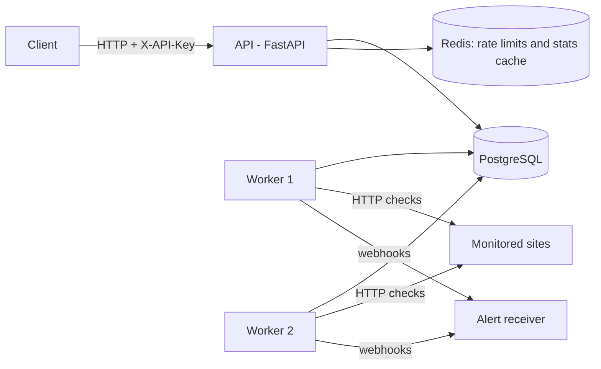
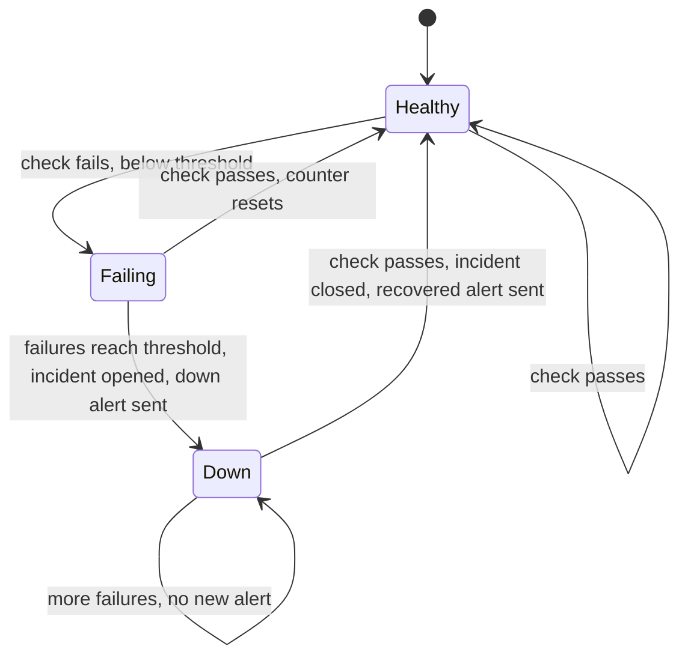

# Sentinel

[](https://github.com/parthchhikara28/sentinel/actions/workflows/ci.yml)


**An uptime monitoring and alerting API.** Register a URL and Sentinel checks it on a schedule, records latency and status, opens an incident after N consecutive failures, and fires a webhook alert. When the site recovers, the incident closes and a recovery alert is sent.

The interesting part is not the CRUD. It is that **several worker processes share one queue of due checks without ever duplicating work**, using nothing but PostgreSQL row locks (`SELECT ... FOR UPDATE SKIP LOCKED`). The evidence is below.

## Highlights

- **Two-process architecture**: a stateless API and a pool of horizontally scalable workers sharing one database.
- **Concurrency-safe scheduling**: workers claim and reschedule due monitors in a single atomic SQL statement. Verified by experiment: duplicates appear without the lock clause and disappear with it.
- **Reliable alerting**: debounced (alert only after N consecutive failures), idempotent (one outage means one "down" alert), sent after the transaction commits, with exponential backoff and jitter.
- **Measured performance**: 5,000 monitors and 500,000 check results, load-tested before and after optimisation, with `EXPLAIN ANALYZE` evidence.
- **Production habits**: migrations, per-user rate limiting, Redis-cached statistics, SSRF protection, graceful shutdown, non-root containers, CI with a coverage gate.

## Architecture



| Process | Responsibility |
|---|---|
| **API** | Monitor CRUD, check history, incidents, uptime statistics, API-key auth, rate limiting |
| **Worker** | Claims due monitors, performs checks, records results, opens and closes incidents, sends alerts |

PostgreSQL is the single source of truth, including the schedule (`monitors.next_check_at`). Redis holds only disposable data: rate-limit counters and cached statistics.

## Quickstart

Requires Docker.

```bash
git clone https://github.com/parthchhikara28/sentinel && cd sentinel
docker compose up --build
```

This starts PostgreSQL, Redis, the API (which applies the migrations) and **two worker replicas**. In another terminal:

```bash
# 1. Create a user. The API key is shown exactly once.
curl -X POST localhost:8000/v1/users \
  -H 'Content-Type: application/json' \
  -d '{"email":"you@example.com"}'

export KEY="sk_..."   # paste the api_key from the response

# 2. Watch a site every 30 seconds
curl -X POST localhost:8000/v1/monitors \
  -H "X-API-Key: $KEY" -H 'Content-Type: application/json' \
  -d '{"name":"example","url":"https://example.com","interval_seconds":30}'

# 3. After a minute, read the stats
curl localhost:8000/v1/monitors/1/stats -H "X-API-Key: $KEY"
```

Interactive API docs: http://localhost:8000/docs

The database password in `docker-compose.yml` is a local development default. Real deployments should supply secrets through the platform, never the repository.

## API overview

All routes except user creation and `/health` require an `X-API-Key` header.

| Method | Route | Purpose |
|---|---|---|
| `POST` | `/v1/users` | Create a user and receive an API key (shown once) |
| `GET` | `/v1/users/me` | Current user |
| `POST` | `/v1/monitors` | Create a monitor |
| `GET` | `/v1/monitors` | List monitors (cursor pagination, includes latest status) |
| `GET` | `/v1/monitors/{id}` | Get one monitor |
| `PATCH` | `/v1/monitors/{id}` | Partial update |
| `DELETE` | `/v1/monitors/{id}` | Stop monitoring (soft delete, history kept) |
| `GET` | `/v1/monitors/{id}/checks` | Check history (cursor pagination) |
| `GET` | `/v1/monitors/{id}/incidents` | Outage history |
| `GET` | `/v1/monitors/{id}/stats?hours=24` | Uptime %, average and p95 latency (cached 30 s) |
| `GET` | `/health` | Liveness probe |

Example webhook payloads:

```json
{
  "event": "down",
  "monitor_id": 1,
  "monitor_name": "example",
  "url": "https://example.com/",
  "cause": "expected 200, got 500",
  "consecutive_failures": 3
}
```

```json
{
  "event": "recovered",
  "monitor_id": 1,
  "monitor_name": "example",
  "url": "https://example.com/",
  "incident_id": 1,
  "downtime_seconds": 150
}
```

## How workers avoid duplicate checks

Every worker runs the same loop: find monitors whose `next_check_at` has passed, check them, store the results, schedule the next check. Running several workers at once creates a race, because two workers waking together would see the same "due" rows.

I considered three designs:

| Approach | Why not |
|---|---|
| One worker only | No redundancy and cannot scale past one machine |
| Redis queue plus a scheduler | The schedule would live in Postgres and the queue in Redis, two sources of truth that can disagree after a crash |
| **Claim rows in Postgres with `FOR UPDATE SKIP LOCKED`** | One source of truth, no extra infrastructure, atomic |

The claim query:

```sql
WITH due AS (
    SELECT id FROM monitors
    WHERE is_active AND next_check_at <= NOW()
    ORDER BY next_check_at
    LIMIT :batch
    FOR UPDATE SKIP LOCKED
)
UPDATE monitors m
SET next_check_at = NOW() + (m.interval_seconds * INTERVAL '1 second')
FROM due
WHERE m.id = due.id
RETURNING m.id, m.url, m.timeout_seconds, m.expected_status,
          m.failure_threshold, m.consecutive_failures, m.webhook_url;
```

- `FOR UPDATE` locks the selected rows for the transaction.
- `SKIP LOCKED` makes a second worker step over locked rows instead of waiting, so the table behaves like a concurrent work queue.
- The `UPDATE` pushes the schedule forward **in the same statement**, so a crash can never leave rows claimed but still due.

### Evidence

I ran two workers polling about 20 times per second against the same monitors, first with the clause removed and then with it restored, and counted monitors checked more than once in the same second.


`tests/test_worker_claim.py` also asserts that two simultaneous claims never overlap and that a claimed monitor is no longer due.

## Alerting and reliability



- **Debouncing**: an incident opens only after `failure_threshold` consecutive failures, so one blip pages nobody.
- **Idempotency**: an "is an incident already open?" guard means one outage sends exactly one "down" alert, even with several workers racing.
- **No network I/O while holding a lock**: webhooks are sent after the database transaction commits, so a slow receiver cannot stall the system.
- **Retries**: exponential backoff plus jitter, so a mass outage does not cause synchronised retry spikes. 4xx responses are not retried, because the request itself is wrong.
- **Lost-update protection**: the monitor row is locked while the failure counter changes, so concurrent results cannot lose an increment.
- **Timeouts everywhere**: every outbound request has an explicit timeout, so a hung server cannot occupy a worker slot forever.
- **Bounded concurrency**: checks run concurrently with `asyncio.gather`, capped by a semaphore so a large batch cannot exhaust sockets.
- **Graceful shutdown**: on SIGTERM, workers finish in-flight checks before exiting.

## Security

- **API keys** are random (`secrets`), shown once, and stored only as a SHA-256 hash. A fast hash is appropriate here because keys are high-entropy random strings, unlike human passwords.
- **Tenant isolation**: ownership is checked inside the SQL query. Another user's monitor returns `404`, never `403`, so existence is not leaked.
- **SSRF guard**: monitor URLs are resolved and rejected if they point at private, loopback, link-local or reserved addresses.
- **Rate limiting**: per user, using an atomic Redis Lua script so the counter and its expiry cannot get out of sync.
- **Input limits**: for example, a minimum check interval of 10 seconds, so one user cannot generate unbounded load.
- **Containers** run as a non-root user.

## Performance

I seeded 5,000 monitors and 500,000 check results, ran a 2-minute Locust test (50 concurrent users) **before changing anything**, then optimised and re-ran the identical test.

| Endpoint | p50 before | p50 after | p95 before | p95 after | req/s before | req/s after |
|---|---|---|---|---|---|---|
| `GET /v1/monitors` | 2 ms | 73 ms | 5 ms | 340 ms | 81.1 | 59.2 |
| `GET /v1/monitors/:id/checks` | 2 ms | 68 ms | 5 ms | 360 ms | 27.2 | 20.4 |
| `GET /v1/monitors/:id/stats` | 2 ms | 80 ms | 5 ms | 360 ms | 53.9 | 39.3 |
| **Total** | 2 ms | 74 ms | 5 ms | 350 ms | 162.1 | 119.0 |

Query plans (`EXPLAIN ANALYZE`, one monitor, 500k rows):

| Query | Before index | After index |
|---|---|---|
| Latest 50 checks | 27.340 ms | 0.188 ms |
| 24h stats aggregate | 23.801 ms | 0.126 ms |

What changed and why it worked:

- **Composite index** on `check_results (monitor_id, checked_at DESC)`. Before, `EXPLAIN ANALYZE` showed Postgres examining hundreds of thousands of rows to return 50. With the index it jumps straight to the monitor's rows. Equality column first, range column second.
- **N+1 removed**: adding `latest_status` to the monitor list naively costs one query per monitor (51 per page). A single `DISTINCT ON` query brings it down to 2. The list endpoint now returns more data than in the baseline, so its numbers are not a like-for-like comparison.
- **Redis cache** on the stats endpoint (30 s TTL, key includes the time window), because it aggregates many rows into a small answer.
- **Connection budget**: each process holds at most 15 connections (pool 10 plus overflow 5), checked against Postgres's default limit of 100.

All figures come from one laptop with the API, database and load generator sharing the same machine, so treat them as relative rather than absolute.

## Testing

```bash
pytest --cov=app
```

- Tests run against a **real PostgreSQL**, because SQLite lacks `SKIP LOCKED` and the aggregate functions used here.
- Coverage includes the API, the alerting state machine (exactly one incident and one alert after five failures, no alert below the threshold, recovery closes the incident) and concurrent claiming.
- **CI** (GitHub Actions) runs lint, applies the Alembic migrations to an empty database, then runs the tests with a coverage gate on every push.

## Configuration

| Variable | Default | Purpose |
|---|---|---|
| `DATABASE_URL` | local Postgres | Async SQLAlchemy URL |
| `REDIS_URL` | `redis://localhost:6379/0` | Redis connection |
| `RATE_LIMIT_REQUESTS` | `60` | Requests per window, per user |
| `RATE_LIMIT_WINDOW_SECONDS` | `60` | Rate-limit window |
| `STATS_CACHE_TTL_SECONDS` | `30` | Stats cache lifetime |
| `WORKER_BATCH_SIZE` | `50` | Monitors claimed per tick |
| `WORKER_CONCURRENCY` | `20` | Simultaneous checks per worker |
| `ALLOW_PRIVATE_URLS` | `false` | Development-only escape hatch for local webhook testing |

## Project structure

```
app/
  api/        HTTP routes and auth dependency
  core/       security, SSRF guard, rate limiter, redis
  db/         models and session handling
  schemas/    request and response models
  worker/     claim query, checker, alerting, run loop
alembic/      database migrations
tests/        API, alerting and concurrency tests
loadtest/     Locust scenario, results and EXPLAIN output
scripts/      seed data, webhook test receiver
```

## Trade-offs and what I would do next

- **Workers poll the database.** At very high check volumes, a leader-elected scheduler pushing to a queue would reduce database load. I chose polling for one source of truth and no extra infrastructure.
- **`check_results` grows without bound.** Production would partition it by month and drop old partitions, or downsample to hourly aggregates after a week.
- **The rate limiter is a fixed window**, so a client can burst up to 2x at a window boundary. A sliding window or token bucket would fix that at the cost of more memory.
- **The SSRF check resolves DNS when a monitor is created** and does not defend against DNS rebinding. A complete fix pins the resolved IP at request time.
- **Migrations run in the API start command.** With several API replicas starting at once, a one-shot migration job would avoid races.
- **No distributed tracing.** OpenTelemetry across API, database and worker would make latency debugging much easier.

## Deployment

Not deployed to a public host. The supported setup is `docker compose up --build`, which runs the whole system locally, including two workers.

## Decisions log

[DECISIONS.md](DECISIONS.md) records what I chose, what I rejected, and why, part by part.
